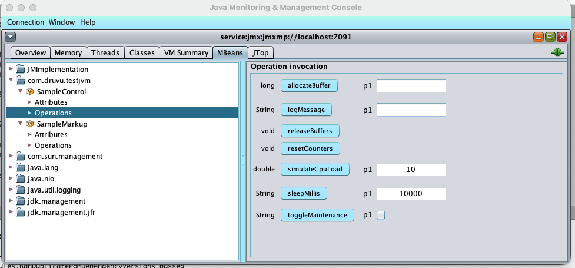
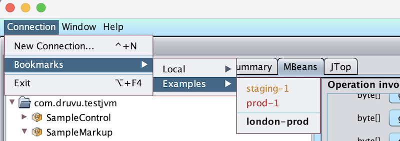
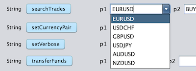

# JConsole Booster

[](https://github.com/DenissLarka/jconsole-booster/actions/workflows/ci.yml)
[](LICENSE)
[](https://openjdk.org/)
[](https://druvu.com/downloads/jconsole-booster.html)
[](https://github.com/DenissLarka/jconsole-booster/releases)

**A maintained, modern JConsole fork for JVM ops engineers who rely on JMX in production.**

[](https://github.com/DenissLarka/jconsole-booster/releases/latest/download/JConsoleBooster.msix)
[](https://github.com/DenissLarka/jconsole-booster/releases/latest/download/JConsoleBooster.dmg)
[](https://github.com/DenissLarka/jconsole-booster/releases/latest/download/JConsoleBooster.AppImage)
[](https://druvu.com/downloads/jconsole-booster.html)

The Java runtime is bundled. Nothing else to install.

## What you get

JConsole Booster is a desktop JMX client. It has JConsole's tabs (Overview, Memory, Threads, Classes, VM Summary,
MBeans) and adds what a day with production JVMs asks for. Version 1.2 is built on JavaFX: one window, one connection,
light and dark themes.

- **JMXMP built in.** One TCP port, easy to forward over SSH. TLS when the server offers it, with trust on first use for
  its certificate. RMI works too, with a full `service:jmx:rmi:` address.
- **Operation forms from descriptions.** Put `{{combo:EUR,USD,GBP}}`, `{{date:dd.MM.yyyy}}`, `{{text:rows=10}}` or
  `{{file:*.csv}}` in a parameter's description. The Operations view then shows a dropdown, a date picker, a text area
  or a file chooser. Other JMX clients show the description as plain text. The descriptor fields `legalValues` and
  `defaultValue` work without any markup.
- **Files from `byte[]` results.** `{{returns:mime=application/pdf}}` on an operation turns its `byte[]` result into a
  file you open or download. Only a short list of types opens; every type can be downloaded.
- **Remembered values.** After a call succeeds, its values are filled in next time, per MBean class, operation and
  parameter.
- **Bookmarks in a text file.** `connections.txt` holds groups, separators, and bold or coloured labels. It is plain
  text, so it syncs through Dropbox or git.
- **TabularData as one table.** The index columns come first and the rows are sorted by them. Copy or save the table as
  CSV.
- **JTop.** The target's threads by CPU time, the busiest first.
- **Console mode.** A text REPL for a terminal or a bastion: browse MBeans, invoke operations, write a thread dump to a
  local file. With `-e` it runs commands and exits, for scripts.
- **A colour per environment.** `-c=#RRGGBB` draws a thin band under the toolbar, so a production window looks different
  from a staging one.
- **Updates itself.** An installed copy offers new releases. It checks each download's SHA-256 before it installs.



## Getting started

### 1. Open a JMXMP port in the target JVM

JMXMP is JMX over one TCP socket: no RMI registry, no second port. [druvu-lib-jmxmp](https://github.com/DenissLarka/druvu-lib-jmxmp)
is the JMXMP library developed alongside JConsole Booster. It is on Maven Central and needs Java 21 or later in the
target. Add its server module:

```xml
<dependency>
    <groupId>com.druvu</groupId>
    <artifactId>druvu-lib-jmxmp-server</artifactId>
    <version>2.0.1</version>
</dependency>
```

Then start a connector next to your MBeans. The server needs only an authenticator; TLS is on by default.

```java
JMXAuthenticator authenticator = credentials -> {
    // credentials is String[] {user, password}
    if (credentials instanceof String[] c && c.length == 2 && passwordMatches(c[0], c[1])) {
        return new Subject(true, Set.of(new JMXPrincipal(c[0])), Set.of(), Set.of());
    }
    throw new SecurityException("Invalid credentials");
};
Map<String, Object> env = new HashMap<>();
env.put(JMXConnectorServer.AUTHENTICATOR, authenticator);

JMXConnectorServer server = JMXConnectorServerFactory.newJMXConnectorServer(
        new JMXServiceURL("service:jmx:jmxmp://0.0.0.0:7091"), env, ManagementFactory.getPlatformMBeanServer());
server.start();
```

Without a keystore, the server makes a self-signed certificate at each start. JConsole Booster asks about it on the
first connection, and again after every restart of the server. To avoid that, give the server a certificate of its own: set
`jmx.remote.tls.socket.factory` in `env`, or start the JVM with `-Djavax.net.ssl.keyStore=…`. The
[druvu-lib-jmxmp README](https://github.com/DenissLarka/druvu-lib-jmxmp#readme) covers the full setup, role-based access
included.

Other servers:

- **Classic JMXMP servers** (the old `jmxremote_optional`, for example
  `org.glassfish.main.external:jmxremote_optional-repackaged`) usually run in plaintext. JConsole Booster connects to
  them, but over plaintext only without a user name: it never sends a password in clear.
- **RMI.** The JDK's own agent (`-Dcom.sun.management.jmxremote.port=…`) is RMI. Connect with a full address, such as
  `service:jmx:rmi:///jndi/rmi://host:9010/jmxrmi`. A password goes only to an RMI connector that uses SSL.
- **Local processes** are not listed and cannot be attached to. Every connection names its address.

### 2. Connect

Start JConsole Booster. Without a target it opens an empty window that says "Not connected". The **Connect** button on
the left of the toolbar opens the connection list:

- **New Connection…** (Cmd/Ctrl+N) opens the Connect dialog: the **Remote process** (`host:port` or a `service:jmx:`
  URL), **Username**, **Password**, and **Require a CA-validated certificate**.
- **Your bookmarks**, one submenu per group. A click opens the Connect dialog on that address. It never connects by
  itself, because a bookmark keeps no password.
- **Add current connection to bookmarks…**, **Open bookmarks file**, **Reconnect** and **Disconnect**.

You can also name the target at launch: `jconsole-booster localhost:7091` (see [Command line](#command-line)). An
address without a protocol, `host:port`, means JMXMP. When that target asks for a password, the Connect dialog opens on
it with the reason, ready for the user name and password.

When no trusted authority signed the server's certificate for this host (a self-signed one, say), a dialog shows its
SHA-256 fingerprint. **Trust** accepts it until JConsole Booster quits. Tick **Remember this certificate…** and it is also written to `trusted-certs.txt`, so later
connections do not ask. [Security model](#security-model) has the rest.

### The window

One window holds one connection. Connecting to another JVM asks first, then replaces the connection. When a connection
is lost, a dialog offers Reconnect.

The tabs are Overview, Memory, Threads, Classes, VM Summary, JTop and MBeans. A new connection opens on MBeans. **Settings ›
Plugins** switches any tab off, from the next connect on; the list fills after the first connection. **Settings ›
Appearance** picks one of nine light and dark themes. Settings opens from the gear on the right of the toolbar, or with
Cmd/Ctrl+, (comma).

The status bar shows the connection's state and the time of the last refresh. While an update downloads, its progress
shows there too. The Help menu holds User Guide (this page), Feedback, Check for Updates... and About.

## Bookmarks

The connection list reads its bookmarks from a plain text file:

```
~/.druvu.com/jconsole-booster/connections.txt
```

The first start writes a commented default. The list reads the file again each time it opens, so an edit shows at once.
The format:

```
# Comments start with #. Blank lines are ignored.

[Production]
order-service@prod-orders:7091
*billing*@prod-billing:7091
[red edge-1]@prod-edge-1:7091
---
legacy@service:jmx:rmi:///jndi/rmi://prod-legacy:9010/jmxrmi

[Staging]
[orange order-service]@stg-orders:7091
```

| Line                      | Effect                                      |
|---------------------------|---------------------------------------------|
| `[Group name]`            | Starts a group: a submenu in the list       |
| `label@address`           | A bookmark in the current group             |
| `---`                     | A separator in the current group            |
| `*text*` in a label       | Bold text                                   |
| `[color text]` in a label | Coloured text                               |

The colours are `red`, `blue`, `green`, `orange`, `gray`, `purple` and `black`. Black is the theme's own text colour, so
it stays readable in a dark theme. The two marks nest, as in `[red *prod*]`. An unknown colour name stays in the label as
written, so a typo shows.

The address after the `@` is `host:port` for JMXMP, or a full `service:jmx:` URL. A bookmark must sit under a group. A
malformed line is skipped, with a warning in the log that names its line number.

**Add current connection to bookmarks…** and the Connect dialog's **Add to bookmarks** put the bookmark at the end of the
group you pick or type; a new group gets its header line. The rest of the file stays as it was: comments, order, markup.
A bookmark stores a label and an address, never a password.


*The default `connections.txt` in the connection list: groups, a separator, coloured and bold labels.*

## Markup reference

JConsole Booster reads a small markup in the descriptions of an MBean's operations and their parameters: `{{tag}}` or
`{{tag:options}}`. The server opts in by writing it. Other JMX clients (JConsole, VisualVM, Mission Control) show it as
part of the description text. Only the first tag in a description counts. The rest of the description, without the tag,
shows in the input's tooltip and in the parameter's help (click the parameter's name).

### Parameter inputs

| Tag                                     | Input                                                        | Example                                          |
|-----------------------------------------|--------------------------------------------------------------|--------------------------------------------------|
| `{{combo:A,B,C}}`                       | A dropdown of these values; another value can be typed       | `"Currency pair {{combo:EURUSD,USDCHF,GBPUSD}}"` |
| `{{date:pattern}}`                      | A date picker that writes the date in this pattern           | `"Settle date {{date:dd.MM.yyyy}}"`              |
| `{{text}}` / `{{text:rows=N,cols=M}}`   | A text area, 8 rows by 20 columns unless told otherwise      | `"Payload {{text:rows=10}}"`                     |
| `{{file}}` / `{{file:*.csv,*.json}}`    | A file chooser, filtered by these patterns                   | `"Upload {{file:*.csv}}"`                        |

Without markup, a parameter still gets a fitting input:

- A `boolean` or `Boolean` parameter gets a check box.
- A parameter whose descriptor lists `legalValues` gets a dropdown of them.
- A descriptor's `defaultValue` fills the input when no value is remembered.
- Anything else gets a text field. Enter in it invokes the operation.

Details:

- `{{combo}}` values are separated by commas, so a value cannot contain one.
- The `{{date}}` pattern is a `java.time.format.DateTimeFormatter` pattern. A pattern the picker cannot write (a time of
  day, a typo) gives a plain text field instead.
- `{{file}}` sends the file's content: as UTF-8 text for a `String` parameter, as bytes for a `byte[]` parameter. A
  file is never remembered.
- An unknown tag is ignored. The parameter gets the input it would have without markup.
- An operation with a parameter that cannot be built from text (other than a `byte[]` with `{{file}}`) is shown
  disabled.
- Right-click an input and choose **Forget this value** to drop what JConsole Booster remembered for it.


*The sample target's operations: each dropdown, date picker and text area comes from its parameter's description.*

### Operation results as files

| Tag, in the operation's description         | Effect                                                |
|---------------------------------------------|-------------------------------------------------------|
| `{{returns:mime=<type>}}`                   | A `byte[]` result is offered as a file of that type   |
| `{{returns:mime=<type>,filename=<name>}}`   | The same, with a file name the server suggests        |

For example `"Monthly report {{returns:mime=application/pdf}}"`. When the operation returns its bytes, a dialog names the
file and its type and offers **Open**, **Download** or **Cancel**. Cancel is the default button. Open is offered only for
these types:

```
application/pdf      application/json      text/plain      text/csv
image/png            image/jpeg            image/gif
application/vnd.openxmlformats-officedocument.spreadsheetml.sheet          (.xlsx)
application/vnd.openxmlformats-officedocument.wordprocessingml.document    (.docx)
application/vnd.openxmlformats-officedocument.presentationml.presentation  (.pptx)
application/vnd.ms-excel                                                   (.xls)
```

Every other type can only be downloaded. That includes `text/html`, `image/svg+xml` and `application/xml`: a browser that
opened them would run the scripts they can carry. The type must match exactly, so `text/csv; charset=utf-8` counts as an
unknown type. The file name comes from the server, so only a cleaned base name is kept. The extension always comes from
the type, and an unknown type gets `.bin`. A `byte[]` result without the tag shows in the value viewer.

### Example: a markup-aware MBean

A plain Standard MBean cannot carry descriptions of your own. Subclass `StandardMBean` and override its
`getDescription(...)` methods:

```java
public class OrderService extends StandardMBean implements OrderServiceMBean {

    public OrderService() throws NotCompliantMBeanException {
        super(OrderServiceMBean.class);
    }

    @Override
    protected String getDescription(MBeanOperationInfo op, MBeanParameterInfo p, int seq) {
        return switch (op.getName()) {
            case "setPair"     -> "Currency pair {{combo:EURUSD,USDCHF,GBPUSD,USDJPY}}";
            case "scheduleAt"  -> "Run-at date {{date:dd.MM.yyyy}}";
            case "uploadCsv"   -> "CSV file {{file:*.csv}}";
            default            -> super.getDescription(op, p, seq);
        };
    }

    @Override
    protected String getDescription(MBeanOperationInfo op) {
        return switch (op.getName()) {
            case "generateReport" -> "Monthly report {{returns:mime=application/pdf}}";
            default               -> super.getDescription(op);
        };
    }

    public String setPair(String pair) { /* ... */ }
    public String scheduleAt(String date) { /* ... */ }
    public String uploadCsv(byte[] payload) { /* ... */ }
    public byte[] generateReport() { /* ... */ }
}
```

A `DynamicMBean` that builds its `MBeanInfo` with `new MBeanParameterInfo(name, type, description)` works as well.

The descriptor fields need no subclass. A Standard MBean sets them with `@DescriptorKey` annotations:

```java
public interface LoggingMBean {
    String changeLogLevel(@LegalValues({"ERROR", "WARN", "INFO", "DEBUG"}) @DefaultValue("INFO") String level);
}

@Retention(RetentionPolicy.RUNTIME)
@Target(ElementType.PARAMETER)
@interface LegalValues {
    @DescriptorKey("legalValues")
    String[] value();
}

@Retention(RetentionPolicy.RUNTIME)
@Target(ElementType.PARAMETER)
@interface DefaultValue {
    @DescriptorKey("defaultValue")
    String value();
}
```

An Open MBean gives `legalValues` and `defaultValue` in its `OpenMBeanParameterInfo`.

## Security model

**No password over plaintext.** A JMXMP connection follows what the server offers: TLS when it offers TLS, plaintext when
it offers nothing. With a user name or password, a server without TLS is refused before the password is sent, and a
dialog says why. RMI gets the same rule: JConsole Booster first reads the server's RMI stub without credentials, and
sends the password only when the stub uses SSL. Only an address of the form
`service:jmx:rmi:///jndi/rmi://host:port/name` can be checked this way; any other RMI address is refused when it comes
with credentials.

**Certificates (JMXMP).** The server's certificate is checked in this order:

1. A trusted authority signed it for this host: accepted without a question.
2. **Require a CA-validated certificate** is ticked (or `open --strict` in the console): anything else is refused.
3. Its SHA-256 is pinned for this `host:port` in `trusted-certs.txt`: accepted without a question.
4. Otherwise JConsole Booster asks, showing the fingerprint:
   - a first-use question for a self-signed or unknown certificate;
   - a louder warning when the certificate differs from the one pinned for this address. A restarted server with a
     self-signed certificate looks like this; so does someone intercepting the connection. Its box replaces the old pin
     with the new one.
   - a warning when an authority signed it, but for other host names, which are listed. Company certificates are often
     deployed this way. Its remember box pins it, so the question comes once.

**Trust** accepts the certificate until JConsole Booster quits. With the dialog's box ticked, it is also written to
`trusted-certs.txt`. Cancel is the default button, and Escape or closing the dialog refuses too. The file is an SSH
`known_hosts` analogue: one `host:port <sha-256>` per line, hand-editable. Delete a line to revoke the trust.

Over RMI with SSL, the Java runtime's own trust store decides. Trust on first use covers JMXMP only.

**What stays on disk.** No connection password is written anywhere. Bookmarks keep a label and an address. Remembered
operation values are stored in plain text under `operation-state/`, a password typed into an operation included; use
**Forget this value** for those. The state file is named after the MBean's class, which comes from the target; the name
is reduced to a plain file name, so a target cannot steer the file out of that folder.

**Returned files.** Nothing opens or saves without your click, and Cancel is the default. Only the types listed in
[Operation results as files](#operation-results-as-files) can be opened. A file opened for you goes to a temporary
folder of its own and is deleted when JConsole Booster quits.

**Network.** JConsole Booster connects to the JVMs you name. An installed copy also asks GitHub's releases API for a
newer version, at start and on Help › Check for Updates.... The offer's dialog has a box to stop the check at start
(`update.check=false` in `preferences.properties`). `DRUVU_UPDATER_OFF=true` in the environment switches updates off
for a run.

## Console mode

`--console` starts a text REPL instead of the window. It connects over JMXMP or RMI with the same protections as the
window: TLS as the server offers it, trust on first use, no password over plaintext. It lets you browse MBeans and invoke
operations. Use it over SSH or on a bastion with no display.

The drill-down is numbered: list the beans, pick one, then call an operation by its number or name. Without arguments on
the line, you are asked for each one by name and type.

| Command                            | Does                                                                  |
|------------------------------------|-----------------------------------------------------------------------|
| `open [--strict] <target> [user]`  | Connects; asks for the password when a user is given                  |
| `beans [filter]`                   | Lists the MBeans, numbered; the filter is a case-insensitive substring |
| `bean <n \| objectName>`           | Selects a bean and lists its operations                               |
| `ops`                              | Lists the selected bean's operations again                            |
| `call <n \| opName> [args…]`       | Invokes an operation of the selected bean                             |
| `invoke <objectName> <op> [args…]` | Invokes without selecting a bean first                                |
| `threads [file]`                   | Writes a thread dump of the target to a local file                    |
| `close`                            | Closes the connection                                                 |
| `version`, `help`, `quit`          | Prints the version, lists the commands, leaves (`exit` works too)     |

```
# interactive: connect, drill down, invoke
jconsole-booster --console
jcb> open localhost:7091 admin
Password for admin:
jcb> beans Cache
jcb> bean com.example:type=Cache
jcb Cache> call clear

# one shot, for scripts: exit code 0 on success, 1 on failure
echo mypassword | jconsole-booster -u=admin \
    -e="invoke com.example:type=Cache clear" localhost:7091
```

At a terminal the password is not echoed. From a pipe it is read as one line.

**Thread dumps.** `threads` writes a full dump of the **target** JVM to a file on the **local** machine, the one running
the console. So it works the same through an SSH tunnel from a bastion:

```
jcb> threads
thread dump written to /home/ops/threaddump-prod-host-7091-20261108-134705.txt (19758 chars, via …)

# unattended capture into a known path
echo mypassword | jconsole-booster -u=admin \
    -e="threads /var/log/incident-4711.txt" prod-host:7091
```

Without an argument the file lands in the current directory as `threaddump-<target>-<timestamp>.txt`. On HotSpot targets
the content is real `jstack -l` output, deadlock analysis and lock sections included, because the dump comes from the
`Thread.print` diagnostic command. Any thread-dump analyser reads it as it is. On other targets it is rebuilt in the same
shape from `ThreadMXBean.dumpAllThreads`, with full stacks and a deadlock summary.

**Unattended runs.** A certificate question reads its answer from the input too, and with no answer it refuses. So pin
the server's certificate once in an interactive session: answer `r` (remember). The window and the console share
`trusted-certs.txt`, so a certificate pinned in the window counts as well.

## Command line

```
jconsole-booster [options] [target]
```

Here `jconsole-booster` stands for the app's launcher:

| Where       | Launcher                                                                                 |
|-------------|------------------------------------------------------------------------------------------|
| macOS       | `/Applications/JConsoleBooster.app/Contents/MacOS/JConsoleBooster`                       |
| Linux       | the AppImage itself: `./JConsoleBooster.AppImage`                                        |
| Windows     | the `.msix` adds no command-line alias; for the console mode, use the plain jar          |
| Any JDK 25+ | the plain jar, console mode only: `java -jar jconsole-booster.jar` (see [Building from source](#building-from-source)) |

### Target

| Form            | Means                                          |
|-----------------|------------------------------------------------|
| `host:port`     | `service:jmx:jmxmp://host:port`                |
| `service:jmx:…` | used as given (JMXMP, RMI, any other protocol) |

The window holds one connection: with several targets it connects to the first and logs that it ignored the others. A
bare process id is refused; every target is an address.

### Options

| Flag                | Description                                                              |
|---------------------|--------------------------------------------------------------------------|
| `-c=#RRGGBB[AA]`    | Draw a 4 px band in this colour under the toolbar.                       |
| `-interval=N`       | Refresh the tabs every N seconds. Default: `4`.                          |
| `-debug`            | Debug logging.                                                           |
| `-version`          | Print the version and the Java runtime's, then exit.                     |
| `-fullversion`      | Print the version line only, then exit.                                  |
| `-h`, `-help`, `-?` | Print the usage and exit.                                                |
| `--console`         | Start the console mode instead of the window.                            |
| `-e=<cmd>`          | Run a console command and exit (repeatable); implies `--console`.        |
| `-u=<user>`         | Console mode: the user name for the target on the command line; the password is asked for. |

## Files and paths

JConsole Booster keeps its files in one folder under your home:

```
~/.druvu.com/jconsole-booster/
├── connections.txt              bookmarks
├── trusted-certs.txt            pinned certificates: host:port and SHA-256, one per line
├── plugins.txt                  tab switches: id=on|off, one per line
├── preferences.properties       the theme, the window's size and place, the update choices
├── operation-state/
│   └── <MBean class>.properties remembered parameter values
└── logs/                        an installed copy's daily log
```

`~` is your home folder on macOS, Windows and Linux alike. The text files are meant to be edited by hand. Deleting one
resets what it holds, and a missing `connections.txt` is written again with the default.

The tab ids in `plugins.txt` are `overview`, `memory`, `threads`, `classes`, `summary`, `jtop` and `mbeans`. A missing id
means on. 1.1's group switch `default-tabs=off` still turns off the five classic tabs, unless a tab has a line of its
own. 1.1 also kept `recent-connections.txt` here. 1.2 no longer reads it, so you can delete it.

To move the folder, to a synced path for example, set the **`JCONSOLE_BOOSTER_HOME`** environment variable. It replaces
the default path entirely.

## JConsole Booster and JConsole

|                      | JConsole (in the JDK)                     | JConsole Booster                                                       |
|----------------------|-------------------------------------------|------------------------------------------------------------------------|
| Toolkit              | Swing                                     | JavaFX, nine light and dark themes                                     |
| Connections          | Local processes, remote RMI               | JMXMP by `host:port`, RMI by full URL; no local attach                 |
| Server certificates  | The Java trust store                      | Trust on first use with pinning (JMXMP), a warning for other host names |
| Operation parameters | A text field each                         | Inputs from `{{markup}}` and descriptors; last values remembered       |
| `byte[]` results     | Shown as an array                         | Opened or downloaded as a file, from `{{returns:mime=…}}`              |
| `TabularData`        | One row at a time                         | One table; copy or save as CSV                                         |
| Bookmarks            | None                                      | A text file with groups and styled labels                              |
| Without a display    | None                                      | Console mode and script mode                                           |
| Updates              | With the JDK                              | Self-update from GitHub releases, SHA-256 checked                      |

## Compatibility

- **The installers** bundle their Java runtime.
  - Windows 10 / 11 (x64): `.msix`
  - macOS 12 Monterey or later (Apple Silicon): `.dmg`
  - Linux x86_64: `.AppImage`. It needs FUSE (`libfuse2` on most distributions), or run it with
    `--appimage-extract-and-run`.
- **The plain jar** (console mode only) runs on any full JDK 25 or later.
- **Target JVMs.** Any JVM with a JMXMP connector (druvu-lib-jmxmp needs Java 21 or later) or an RMI connector. The
  markup needs the target's MBeans to carry their own descriptions: a `StandardMBean` subclass that overrides
  `getDescription(...)`, or a `DynamicMBean` that builds its `MBeanInfo`.

## Which direction next?

If JMX is part of your day, I'd genuinely like to hear what still fights you. [Open an
issue](https://github.com/DenissLarka/jconsole-booster/issues/new): bug reports, questions and ideas are all welcome.
**Help › Feedback** in the app opens the issue list.

## Building from source

You need a JDK 27 that bundles JavaFX (Azul Zulu FX 27; the build refuses any other major version) and Maven 3.9+.

The app depends on druvu-lib-fx, which is published on GitHub Packages only. GitHub Packages asks for a token even for a
public package: create a [personal access token](https://github.com/settings/tokens) with the `read:packages` scope and
add it to `~/.m2/settings.xml` under the server id `github`:

```xml
<settings>
  <servers>
    <server>
      <id>github</id>
      <username>YOUR_GITHUB_USERNAME</username>
      <password>YOUR_TOKEN_WITH_read:packages</password>
    </server>
  </servers>
</settings>
```

Or do what CI does: clone [druvu-lib-fx](https://github.com/DenissLarka/druvu-lib-fx), check out the tag that
`jconsole-booster-fx/pom.xml` names (`v2.1.0`), and `mvn install` it first.

```bash
git clone https://github.com/DenissLarka/jconsole-booster.git
cd jconsole-booster
mvn clean verify
```

The UI tests need a display. On a headless Linux box, run the build under `xvfb-run`, as CI does.

The repository is a Maven reactor:

| Module                            | Holds                                                                                     |
|-----------------------------------|-------------------------------------------------------------------------------------------|
| `jconsole-booster-core`           | The JMX session without a UI toolkit: connecting, trust, bookmarks, operation state, the markup |
| `jconsole-booster-protocol-jmxmp` | The JMXMP transport on druvu-lib-jmxmp, found by the core at run time                     |
| `jconsole-booster-console`        | The console mode, and the plain jar built from it                                         |
| `jconsole-booster-sample-target`  | A sample target JVM: a secured JMXMP endpoint (`admin`/`admin`) with MBeans for the markup |
| `jconsole-booster-fx`             | The JavaFX app: the tab API, the charts, one module per tab, and the app itself           |
| `jconsole-booster-scenarios`      | End-to-end tests over the sample target, and the test that keeps the modules in layers    |

The modules without a UI compile for Java 25, so the console runs on any JDK 25 or later. The JavaFX modules compile for
Java 27. The tabs are found at run time through [druvu-lib-loader](https://github.com/DenissLarka/druvu-lib-loader). The
app is the module `com.druvu.jconsole.app`.

### Run it from source

Start the sample target in one terminal, then the app in another:

```bash
mvn -pl jconsole-booster-sample-target -am compile exec:exec@start-target -Dtarget.port=7091
mvn -pl jconsole-booster-fx/jconsole-booster -am compile exec:exec@start
```

Connect to `localhost:7091` as `admin` / `admin` and trust the sample target's self-signed certificate. Add
`-Djconsole.target=localhost:7091` to the second command to connect at start. A run from source never updates itself.

### The plain jar (no installer)

An opt-in profile shades the [console mode](#console-mode) into one plain (non-JPMS) executable jar. Copy it with `scp`
onto a server or a bastion where no installer or display is available:

```bash
mvn -Puberjar -pl jconsole-booster-console -am package
java -jar jconsole-booster-console/target/dist/jconsole-booster.jar localhost:7091   # the console REPL
```

It needs no GitHub token, since the console does not use druvu-lib-fx. It runs on any full JDK 25 or later; unlike the
installers, it bundles no Java runtime.

## License

JConsole Booster is licensed under the **GNU General Public License v2 with the Classpath Exception**, inherited from
upstream OpenJDK JConsole. See [LICENSE](LICENSE) for the full text. The themes come from
[AtlantaFX](https://github.com/mkpaz/atlantafx) (MIT). The toolbar icons are from Phosphor Icons (MIT); see
[NOTICE.md](NOTICE.md).

---

JConsole Booster is a [druvu](https://druvu.com) product.
